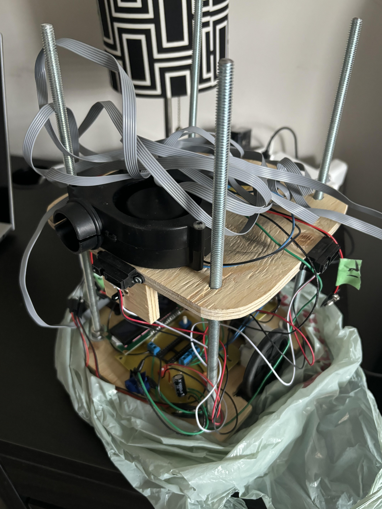

# Fire Extinguishing Robot

An autonomous robot that navigates a multi-room maze, finds a flame, and extinguishes it. It runs on an ATmega328P with custom-designed PCBs. Built as a team of 2

**Result:** located and extinguished the target in **9 of 10 trial runs**.

## What it does
- Navigates the maze autonomously using a state machine
- Detects the flame and extinguishes it with [fan / other mechanism]
- Detects faults and retries when it gets [stuck / loses the wall]

## Hardware
- **MCU:** ATmega328P
- **Sensors (4):** [e.g. IR flame sensor, ultrasonic distance sensors, line sensor]
- **Actuators:** [drive motors + motor driver, fan]
- **PCBs:** custom-designed in [KiCad / Eagle] over 3 revisions, fixing power and signal-noise issues found in testing

## Firmware design
State machine: `[SEARCH] → [NAVIGATE] → [FLAME_DETECTED] → [EXTINGUISH] → [RETURN/DONE]`, with a `[RECOVERY]` state for retry on faults.

## My role
- Wrote the navigation and state machine firmware
- Designed PCB revisions 2 and 3
